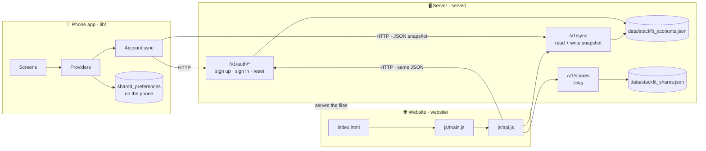
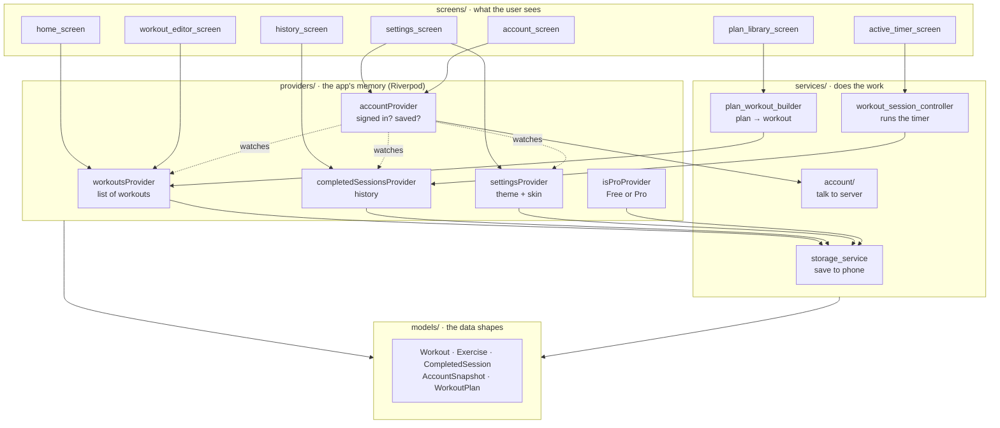
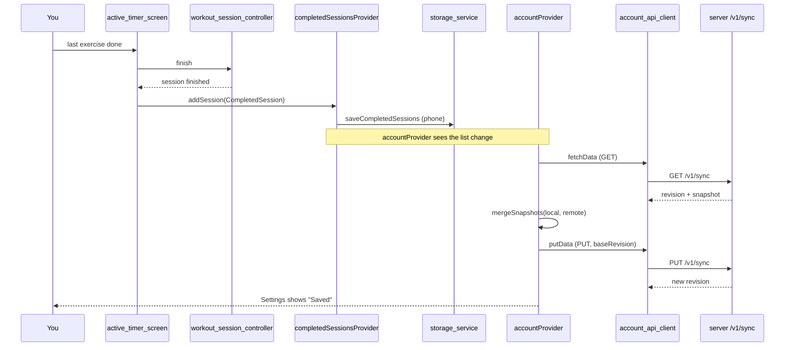
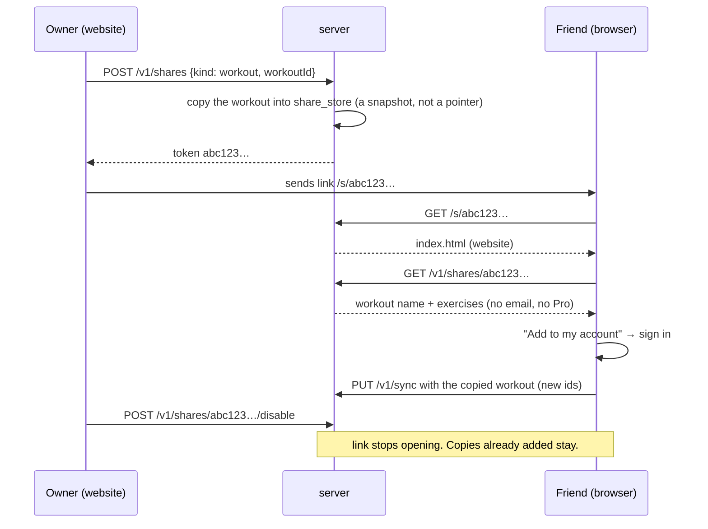
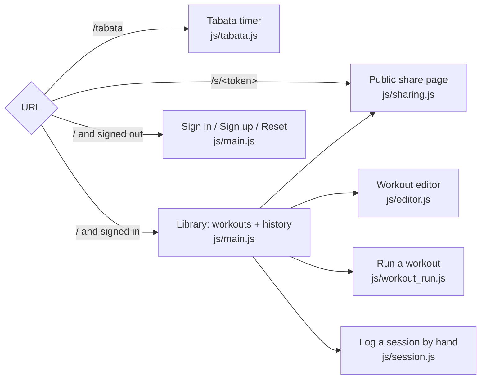

# StackFit – Map of the program

A picture-first guide to how the pieces fit. Open this file in Cursor's markdown
preview (`Ctrl+Shift+V`) so the diagrams render.

Start with section 1. Jump to section 7 when you need to find a file.

---

## 1. The three parts

StackFit is three programs that share one shape of data, the **snapshot**
(workouts + history + theme). Each part can be worked on alone.



What each part is:

| Part | Language | Starts with | Talks to |
|------|----------|-------------|----------|
| Phone app | Flutter / Dart | `lib/main.dart` | Server (optional, only when signed in) |
| Server | Dart (shelf) | `server/bin/server.dart` | Two JSON files on disk |
| Website | Plain HTML + JS | `website/index.html` | Server |

The phone app works with no server and no account. The server and website are
only for keeping data on an account and sharing it.

---

## 2. Inside the phone app

Four layers, top to bottom. A layer only talks to the one below it.



The dotted lines are the key idea for sync: `accountProvider` watches the three
data providers. Whenever a workout, a session, or the theme changes, it uploads.
Screens never talk to the server directly.

---

## 3. What happens when you finish a workout on the phone



If the server is unreachable the chain stops at `storage_service`. Data is on the
phone, Settings shows "Offline", and the next change or app resume tries again.

---

## 4. How two devices agree (sync rules)

Every upload sends `baseRevision`, the revision number the device last saw.
The server refuses with **409** if someone else saved in between. The device
merges and retries, up to three times.


Merge rules live in `lib/services/account/snapshot_merge.dart` and are mirrored
in `website/js/snapshot.js`:

| Data | Rule |
|------|------|
| Workouts | newer `updatedAt` wins; a deletion wins if it is as new as the edit |
| History | union by id, so the same session is never stored twice |
| Theme + skin | newer `appearanceUpdatedAt` wins |
| Pro | not in the snapshot at all; it stays a store purchase on the phone |

---

## 5. Sharing a workout by link



Progress links (`kind: progress`) work the same way but are read-only: no
"Add to my account" button.

---

## 6. Website: which URL opens what

`js/main.js` reads the URL once at start and picks a view.



The server (`server/lib/app_handler.dart`) decides: anything under `/v1/` is
API, `/tabata` and `/s/…` return `index.html`, everything else is a static file
from `website/`.

---

## 7. File map

One line per file. Folders are in the order you will usually need them.

### Root

```
README.md             How to run the app, server, and website
GUIDE.md              This file
NEXT_VERSION.md       Plan + acceptance criteria for accounts and sync
SHARING_PLAN.md       Plan + acceptance criteria for share links
pubspec.yaml          Flutter dependencies
analysis_options.yaml House style the phone app is checked against
.cursor/rules/
  keep-guide-current.mdc   Tells the AI agent to update this file whenever it adds, moves, or removes code
  keep-code-sharp.mdc      Tells the AI agent to keep screens, providers, services, and models in their own layers
```

### `icon/` – home-screen picture

```
icon.png              Home-screen icon picture. Black background, blue dumbbell, 1024×1024
```

### `lib/` – phone app

```
main.dart                         App entry. Sets up Riverpod, theme, and re-syncs when the app resumes.

core/
  constants.dart                  App name, free limits (3 workouts, 10 sessions), server URL
  theme.dart                      Builds light and dark themes from a skin's colours, font, corners, and spacing
  skins.dart                      Everyday skins plus Pro anime skins, including each anime preview picture
  theme_mode_codec.dart           Converts ThemeMode <-> the "system/light/dark" text saved on the account
  utils.dart                      Small helpers: new ids, duration formatting

models/                           Data shapes. Every one has toJson / fromJson.
  models.dart                     One import that re-exports all models
  exercise_type.dart              enum: timer or sets
  exercise.dart                   One exercise: name + work/rest/rounds, or sets/reps/rest
  workout.dart                    A named list of exercises, optional Home section, createdAt / updatedAt
  completed_session.dart          One history row: workout name, when, how long, how many exercises
  set_log.dart                    Reps and kg for one set, saved on a finished session
  catalog_exercise.dart           The built-in offline exercise catalog (27 exercises)
  app_settings.dart               Theme mode + skin
  account_snapshot.dart           The snapshot: workouts + deletions + sessions + appearance. What syncs.
  workout_plan.dart               A read-only built-in plan and its days
  plans/
    plan_library.dart             Lists every built-in plan, by category, with search
    plan_helpers.dart             Shorthand builders used by the plan files below
    gym_plans.dart                5x5, Push/Pull/Legs, Upper/Lower, …
    home_plans.dart               HIIT, core, kettlebell, calisthenics
    running_plans.dart            Couch to 5K, speed work
    endurance_plans.dart          Swimming, cycling, rowing, triathlon brick
    combat_and_sport_plans.dart   Boxing, jump rope, soccer conditioning
    mobility_plans.dart           Stretching and mobility
  FitTimer_CURSOR_CONTEXT.md      Old project brief (still says "FitTimer"; out of date)

providers/                        Riverpod state. Screens read from here.
  app_providers.dart              Wires SharedPreferences, StorageService, AccountStorage, AccountApiClient
  workouts_provider.dart          The workout list + add/edit/delete/duplicate + sections + the free-limit check
  completed_sessions_provider.dart  History list, newest first, free cap of 10, plus per-workout history
  settings_provider.dart          Theme and skin
  pro_provider.dart               Free or Pro flag
  account_provider.dart           Signed in? Saving? Runs the whole sync loop from section 3 and 4.

services/                         Does the work the providers ask for.
  storage_service.dart            Reads and writes workouts, history, Pro, settings to the phone
  workout_session_controller.dart Runs a workout: countdowns, set prompts, rest, skip, pause, stop
  sound_service.dart              Beeps and haptics on phase changes
  plan_workout_builder.dart       Turns a plan day into a workout; multi-day plans share a section
  account/
    account_api_client.dart       HTTP calls to the server (/v1/auth, /v1/sync, /v1/profile)
    account_storage.dart          Saves who is signed in, plus sync bookkeeping (deletions, unmoved data)
    snapshot_merge.dart           The merge rules from section 4

screens/                          One folder per screen.
  home/home_screen.dart           Workout list grouped into sections, + button, Plans / History / Settings
  home/section_dialogs.dart       Name a section, move workouts in, pick which days to group
  workout_editor/workout_editor_screen.dart   Create or edit a workout, reorder and delete exercises, optional section
  exercise_editor/exercise_editor_screen.dart Create or edit one exercise (timer or sets)
  catalog/catalog_screen.dart     Searchable exercise catalog to pick from
  active_timer/active_timer_screen.dart       The big timer. Uses workout_session_controller.
  active_timer/active_timer_card.dart         WORK / REST / SET countdown card
  active_timer/workout_complete_screen.dart   "Done" screen; writes the history session
  history/history_screen.dart     Completed sessions across every workout
  history/workout_history_screen.dart  Past sessions of one workout
  plans/plan_library_screen.dart  Browse built-in plans by category or search
  plans/plan_detail_screen.dart   Days of one plan; Start and Add are Pro
  settings/settings_screen.dart   Theme, everyday skins, Pro skins, Pro, account card
  account/account_screen.dart     Sign up / sign in / reset password forms

widgets/                          Reusable pieces used by several screens.
  workout_tile.dart               One workout row on Home (edit / history / section / duplicate / delete)
  workout_section_card.dart       A named folder of days on Home, like Bro Split
  workout_limit_banner.dart       "2 of 3 workouts" banner for Free users
  exercise_editor_tile.dart       One exercise row inside the workout editor
  plan_card.dart                  One plan in the Plan Library
  plan_library_tile.dart          Home row that opens the Plan Library
  number_stepper.dart             Minus / number / plus control for reps and kg
  set_tracker.dart                Per-set log panel during a workout
  set_log_list.dart               Finished sets grouped by exercise
  session_tile.dart               One history row (date, duration, reps × kg)
  skin_picker.dart                Grid of skins in Settings
  skin_artwork.dart               Skin picture on Home and behind a workout
  account_settings_card.dart      The account box in Settings: email, Saved/Saving/Offline, sign out, move data
  empty_state.dart                Centered "nothing here yet" message
```

### `server/` – account and share API

```
pubspec.yaml                      Server dependencies
analysis_options.yaml             House style the server is checked against
bin/server.dart                   Start here. Loads the two JSON files, serves API + website on :8787
lib/
  app_handler.dart                Decides: /v1/* → API, /tabata and /s/… → index.html, else static file
  account_handler.dart            The /v1/auth/*, /v1/profile, /v1/sync routes. Validates input.
  account_store.dart              Users, passwords (hashed), tokens, reset codes, each user's snapshot + revision
  share_routes.dart               The /v1/shares routes: create, list, read public, disable
  share_store.dart                Saved share links. Separate file from accounts on purpose.
  password_hash.dart              PBKDF2 hashing and checking
data/
  stackfit_accounts.json          Everything account_store holds (local dev data)
  stackfit_shares.json            Everything share_store holds
test/
  account_server_test.dart        Sign up, sign in, sync, conflicts
  share_server_test.dart          Create, open, disable links
  website_server_test.dart        Website is served and does not hide the API
```

### `website/` – browser site

```
index.html                        All the panels (sign in, library, editor, run, share, tabata). JS shows/hides them.
styles.css                        Styling
js/
  main.js                         Start here. Wires buttons, picks a view from the URL, draws workouts (grouped by section) + history
  api.js                          fetch() calls to the server. Same endpoints as account_api_client.dart
  snapshot.js                     Empty snapshot, merge rules, id and date helpers
  editor.js                       Workout editor form: open, read the draft, validate
  session.js                      "Log a session" form
  workout_run.js                  Run a workout in the browser (work/rest countdown, sets)
  tabata.js                       The /tabata page: classic 20/10 × 8 timer, savable when signed in
  sharing.js                      Share buttons, the public /s/… page, "Add to my account", paste-a-routine
```

### `StackFitWeb/` – anime theme art

```
themes/README.md                  What the four anime themes are for
themes/bold-sports/               Bold Sports art. Settings uses icons/banner.jpg
themes/chibi/                     Chibi art. Settings uses icons/banner.jpg
themes/cyberpunk/                 Cyberpunk art. Settings uses icons/banner.jpg
themes/dumbbell/                  Dumbbell art. Settings uses icons/banner-home.jpg
```

### `test/` – phone app tests

```
widget_test.dart                  Home screen renders
snapshot_merge_test.dart          Merge rules
website_snapshot_test.dart        Phone can read a snapshot the website wrote
plan_library_test.dart            Plans have unique ids, and Home sections group plan days
set_log_test.dart                 Set logging, kg, and history JSON
skin_look_test.dart               Each skin's corners, spacing, and typeface
```

---

## 8. Words used in the code

| Word | Means |
|------|-------|
| **Snapshot** | Everything on one account in one JSON object: workouts, deleted workout ids, sessions, theme, skin. |
| **Session** (history) | One finished workout: `CompletedSession`. |
| **Session** (account) | Who is signed in: `AccountSession` (email + token). Different thing, same word. |
| **Revision** | A counter the server bumps on every save. Used to spot two devices saving at once. |
| **Provider** | A Riverpod object that holds state and tells screens when it changes. |
| **Notifier** | The class inside a provider that actually changes the state. |
| **Handler / route** | A server function that answers one URL. |
| **Store** (server) | A class that owns one JSON file and all reads/writes to it. |
| **Token** (account) | A secret string proving you are signed in. Sent as `Authorization: Bearer …`. |
| **Token** (share) | The random part of a share link, `/s/<token>`. Not secret, just hard to guess. |
| **Section** | A named folder on Home that groups workouts (for example Bro Split → Chest, Back). Stored on each workout. |
| **Pro skin** | A fun theme, such as anime, listed under Pro skins. Everyday skins stay available without Pro. |
| **Unmoved data** | Workouts made on the phone before signing in, waiting for "Move to my account". |
| **Origin** | Whether the phone's data came from the device or from the account. Decides if "move" is offered. |

---

## 9. Running things

```bash
# phone app
flutter pub get
flutter run

# server + website (from the server/ folder)
cd server
dart pub get
dart run bin/server.dart          # then open http://127.0.0.1:8787

# tests
flutter test                      # phone app
cd server && dart test            # server

# style and mistakes (the rules in analysis_options.yaml)
flutter analyze                   # phone app
cd server && dart analyze         # server

# rebuild phone and Windows icons after replacing icon/icon.png
dart run flutter_launcher_icons
```
