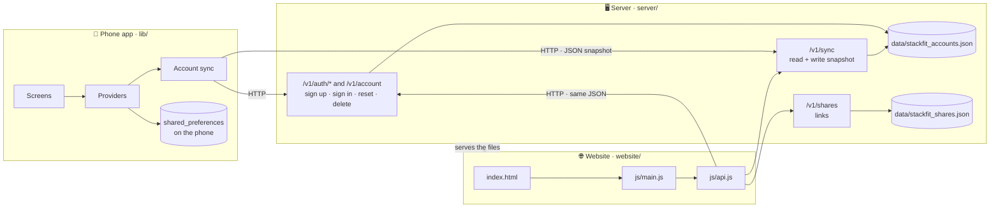
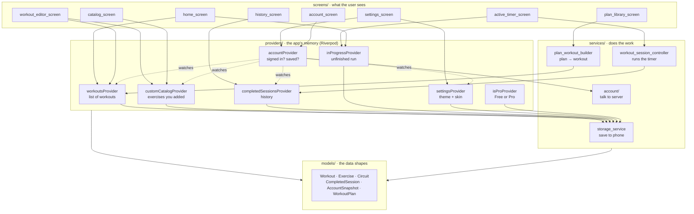
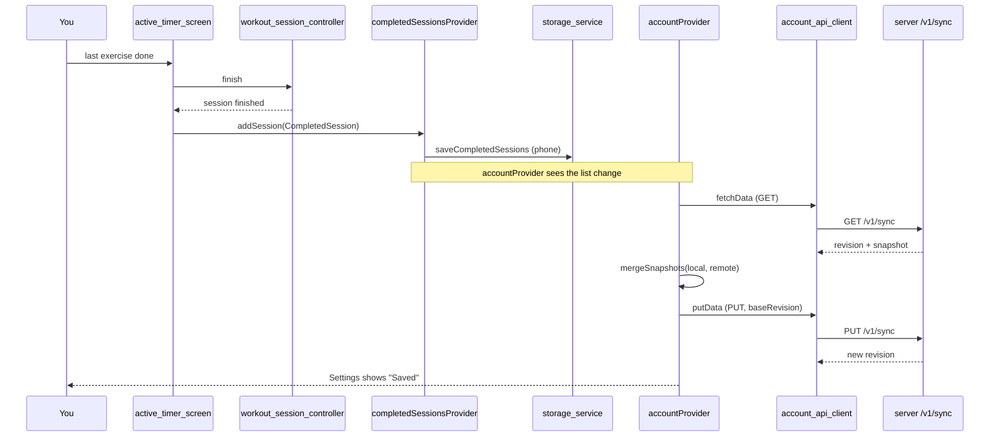
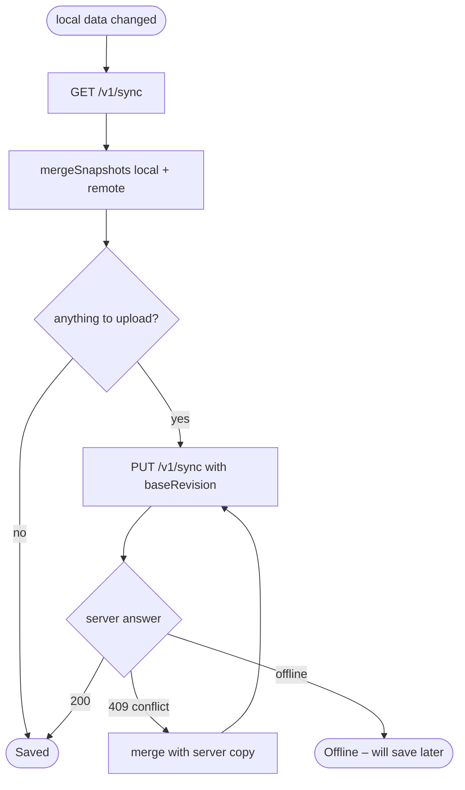
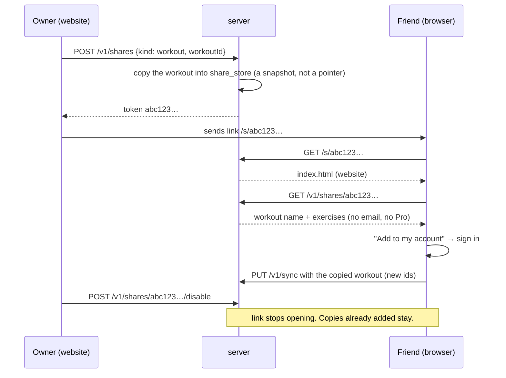
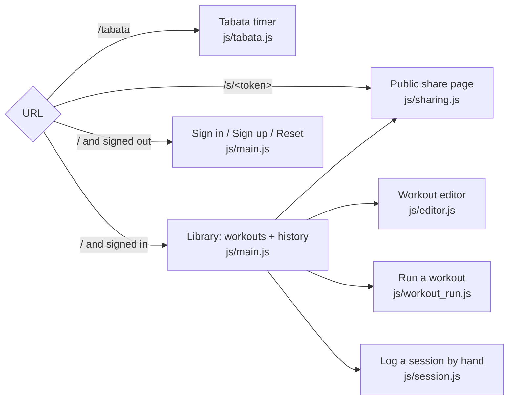

# StackFit – Map of the program

A picture-first guide to how the pieces fit. Open this file in Cursor's markdown
preview (`Ctrl+Shift+V`) so the diagrams render.

Start with section 1. Jump to section 7 when you need to find a file.

---

## 1. The three parts

StackFit is three programs that share one shape of data, the **snapshot**
(workouts + history + theme). Each part can be worked on alone.



What each part is:

| Part | Language | Starts with | Talks to |
|------|----------|-------------|----------|
| Phone app | Flutter / Dart | `lib/main.dart` | Server (optional, only when signed in) |
| Server | Dart (shelf) | `server/bin/server.dart` | Two JSON files on disk |
| Website | Plain HTML + JS | `website/index.html` | Server |

The phone app works with no server and no account. The server and website are
only for keeping data on an account and sharing it.

---

## 2. Inside the phone app

Four layers, top to bottom. A layer only talks to the one below it.



The dotted lines are the key idea for sync: `accountProvider` watches the
workout list, history, theme, and custom exercises. Whenever one of those
changes, it uploads. Screens never talk to the server directly.

An unfinished workout is saved by `inProgressProvider` on the phone only. It
is not part of the account snapshot. Reset, or Start over on Home, clears it.

---

## 3. What happens when you finish a workout on the phone



If the server is unreachable the chain stops at `storage_service`. Data is on the
phone, Settings shows "Offline", and the next change or app resume tries again.

---

## 4. How two devices agree (sync rules)

Every upload sends `baseRevision`, the revision number the device last saw.
The server refuses with **409** if someone else saved in between. The device
merges and retries, up to three times.



Merge rules live in `lib/services/account/snapshot_merge.dart` and are mirrored
in `website/js/snapshot.js`:

| Data | Rule |
|------|------|
| Workouts | newer `updatedAt` wins; a deletion wins if it is as new as the edit |
| History | union by id, so the same session is never stored twice |
| Custom exercises | union by name, ignoring case; the local copy is kept when both have it |
| Theme + skin | newer `appearanceUpdatedAt` wins |
| Pro | not in the snapshot at all; it stays a store purchase on the phone |

---

## 5. Sharing a workout by link



Progress links (`kind: progress`) work the same way but are read-only: no
"Add to my account" button.

---

## 6. Website: which URL opens what

`js/main.js` reads the URL once at start and picks a view.



The server (`server/lib/app_handler.dart`) decides: anything under `/v1/` is
API, `/tabata` and `/s/…` return `index.html`, everything else is a static file
from `website/`. `privacy.html` is the privacy policy, at `/privacy.html`.

---

## 7. File map

One line per file. Folders are in the order you will usually need them.

### Root

```
README.md             How to run the app, server, and website
GUIDE.md              This file
NEXT_VERSION.md       Plan + acceptance criteria for accounts and sync
SHARING_PLAN.md       Plan + acceptance criteria for share links
pubspec.yaml          Flutter dependencies
analysis_options.yaml House style the phone app is checked against
.cursor/rules/
  keep-guide-current.mdc   Tells the AI agent to update this file whenever it adds, moves, or removes code
  keep-code-sharp.mdc      Tells the AI agent to keep screens, providers, services, and models in their own layers
  test-in-browser.mdc      Tells the AI agent to open the phone app at http://127.0.0.1:8181
  debug-playbook.mdc       Tells the AI agent to follow Section 10 when debugging or checking that the app still feels smooth
```

### `icon/` – home-screen picture

```
icon.png              Home-screen icon picture. Black background, blue dumbbell, 1024×1024
app-store-header.png  App Store header and search image. Same dumbbell, 5244×2950
```

### `web/` – the same phone app, opened in a browser

```
index.html            Browser page that loads the app. Open http://127.0.0.1:8181
manifest.json         Name and colours if the browser offers to install the app
favicon.png           Tiny icon in the browser tab
icons/                Larger icons for that install prompt
```

### `lib/` – phone app

```
main.dart                         App entry. Sets up Riverpod, theme, and re-syncs when the app resumes.

core/
  constants.dart                  App name, free limits (3 workouts, 10 sessions), server URL
  theme.dart                      Builds light and dark themes from a skin's colours, font, corners, and spacing
  page_transition.dart            Soft fade/slide between screens; keeps Home tappable after Done
  skins.dart                      Skin names, and which colours and corners go with each one
  skin_looks.dart                 Corners, spacing, and fonts for each skin
  skin_palettes.dart              Light and dark colours for each skin
  theme_mode_codec.dart           Converts ThemeMode <-> the "system/light/dark" text saved on the account
  utils.dart                      Small helpers: new ids, duration formatting

models/                           Data shapes. Every one has toJson / fromJson.
  models.dart                     One import that re-exports all models
  exercise_type.dart              enum: timer or sets
  exercise.dart                   One exercise: name + work/rest/rounds, or sets/reps/rest
  circuit.dart                    A circuit: exercises that play in order, then repeat
  workout.dart                    A named list of exercises and circuits, optional Home section, createdAt / updatedAt
  completed_session.dart          One history row: workout name, when, how long, how many exercises
  in_progress_workout.dart        A run you left early: place, logged sets, and time, on the phone only
  set_log.dart                    Reps and kg for one set, saved on a finished session, with the circuit round
  catalog_exercise.dart           One catalog row, the built-in list, and search
  custom_catalog.dart             Adds an exercise you made under Custom, or updates that name
  app_settings.dart               Theme mode + skin
  account_snapshot.dart           The snapshot: workouts, deletions, sessions, custom exercises, appearance. What syncs.
  workout_plan.dart               A read-only built-in plan and its days
  plans/
    plan_library.dart             Lists every built-in plan, by category, with search
    plan_helpers.dart             Shorthand builders used by the plan files below
    gym_plans.dart                5x5, Push/Pull/Legs, Upper/Lower, …
    home_plans.dart               HIIT, core, kettlebell, calisthenics
    running_plans.dart            Couch to 5K, speed work
    endurance_plans.dart          Swimming, cycling, rowing, triathlon brick
    combat_and_sport_plans.dart   Boxing, jump rope, soccer conditioning
    mobility_plans.dart           Stretching and mobility
  FitTimer_CURSOR_CONTEXT.md      Old project brief (still says "FitTimer"; out of date)

providers/                        Riverpod state. Screens read from here.
  app_providers.dart              Wires SharedPreferences, StorageService, AccountStorage, AccountApiClient
  workouts_provider.dart          The workout list + add/edit/delete/duplicate + sections + the free-limit check
  custom_catalog_provider.dart    Exercises you added, listed in the catalog under Custom
  completed_sessions_provider.dart  History list, newest first, free cap of 10, plus per-workout history. Can drop one exercise from a session
  in_progress_provider.dart       Unfinished workouts on the phone. Not uploaded with the account
  settings_provider.dart          Theme and skin
  pro_provider.dart               Free or Pro flag
  account_state.dart              Signed in or not, saving/offline/error, and whether old device data is waiting
  account_provider.dart           Sign up, sign in, reset password, sign out, delete account, and "move my workouts"
  account_sync.dart               What happens after sign-in, and when a workout, session, theme, or custom exercise changes

services/                         Does the work the providers ask for.
  storage_service.dart            Reads and writes workouts, history, unfinished runs, custom exercises, Pro, and settings
  workout_session_state.dart      Where the timer is: block, round, exercise, work/rest/set, seconds left, paused
  session_set_log.dart            Reps and kg typed in while a workout is still running
  previous_set_log.dart           Last time's reps and kg, on the log and in the add fields
  station_exit.dart               Rest between circuit stations and between rounds
  workout_session_controller.dart Pause, skip, reset, and Done. Can continue a saved place
  workout_session_phases.dart     What happens when work ends, rest ends, a circuit loops, or the clock ticks
  sound_service.dart              Beeps and haptics on phase changes
  plan_workout_builder.dart       Turns a plan day into a workout; multi-day plans share a section
  account/
    account_api_client.dart       HTTP calls to the server (/v1/auth, /v1/account, /v1/sync, /v1/profile)
    account_storage.dart          Saves who is signed in, plus sync bookkeeping (deletions, unmoved data)
    snapshot_merge.dart           The merge rules from section 4

screens/                          One folder per screen.
  home/home_screen.dart           Workout list grouped into sections, continue rows, + button, Plans / History / Settings
  home/home_actions.dart          Start or continue, start over, create, delete, duplicate, and section changes
  home/section_dialogs.dart       Name a section, move workouts in, pick which days to group
  workout_editor/workout_editor_screen.dart   Create or edit a workout, including a circuit box. Saving one exercise writes the workout
  workout_editor/workout_editor_actions.dart  Add an exercise or a circuit, and edit the stations inside it
  exercise_editor/exercise_editor_screen.dart Create or edit one exercise (timer or sets)
  catalog/catalog_screen.dart     Searchable catalog: built-in exercises plus ones you added
  active_timer/active_timer_screen.dart       The big timer. Saves an unfinished run and can continue it.
  active_timer/timer_controls.dart            Done, skip rest, pause, skip, reset, and stop. Logging hides pause and skip
  active_timer/active_timer_card.dart         WORK and REST countdown, drawn on the background
  active_timer/workout_complete_screen.dart   Done screen. Saves the session and always returns to Home.
  history/history_screen.dart     Completed sessions across every workout
  history/workout_history_screen.dart  Past sessions of one workout
  plans/plan_library_screen.dart  Browse built-in plans by category or search
  plans/plan_detail_screen.dart   Days of one plan. Start continues an unfinished day. Add is Pro
  settings/settings_screen.dart   Theme, everyday skins, Pro skins, Pro, account card
  account/account_screen.dart     Decides sign up, sign in, and reset. Does not call the server itself
  account/account_auth_form.dart  The email, password, and reset-code fields
  account/delete_account_dialog.dart  Password confirm before an account is deleted

widgets/                          Reusable pieces used by several screens.
  workout_tile.dart               One workout row on Home. Shows In progress, with Start over when a run is saved
  workout_section_card.dart       A named folder of days on Home, like Bro Split
  workout_limit_banner.dart       "2 of 3 workouts" banner for Free users
  exercise_editor_tile.dart       One exercise row inside the workout editor
  workout_block_list.dart         The editor list: loose exercises and circuit boxes
  plan_card.dart                  One plan in the Plan Library
  plan_library_tile.dart          Home row that opens the Plan Library
  number_stepper.dart             Minus / number / plus; type the number in place
  set_tracker.dart                Per-set log panel during a workout
  set_tracker_rows.dart           One set row: today's reps, and what that set was last time
  log_row_swipe.dart              Short swipe that removes one exercise log, like marking a task done
  set_log_list.dart               Finished sets grouped by exercise. History swipes one exercise away
  session_tile.dart               One history row. Tap opens that session's sets
  skin_picker.dart                Grid of skins in Settings
  collapsible_section.dart        A settings card that stays closed until you tap Show
  skin_artwork.dart               Big girl on Home, empty gym behind dark anime screens, skin mascot
  chibi_run.dart                  Chibi run cycle that crosses the workout-complete screen
  skin_panel.dart                 Holder: solid on everyday skins, Home-style glass on anime skins
  account_settings_card.dart      The account box in Settings: email, Saved/Saving/Offline, sign out, delete account, move data
  empty_state.dart                Centered "nothing here yet" message
```

### `server/` – account and share API

```
pubspec.yaml                      Server dependencies
analysis_options.yaml             House style the server is checked against
bin/server.dart                   Start here. Loads the two JSON files, serves API + website on :8787
lib/
  app_handler.dart                Decides: /v1/* → API, /tabata and /s/… → index.html, else static file
  account_handler.dart            The /v1/auth/*, /v1/account, /v1/profile, /v1/sync routes. Validates input.
  account_store.dart              Sign up, sign in, tokens, reset codes, delete account, and saving a snapshot
  account_records.dart            How a user, a reset code, and a snapshot are written in the JSON file
  share_routes.dart               The /v1/shares routes: create, list, read public, disable
  share_store.dart                Saved share links. Removed when that account is deleted.
  password_hash.dart              PBKDF2 hashing and checking
data/
  stackfit_accounts.json          Everything account_store holds (local dev data)
  stackfit_shares.json            Everything share_store holds
test/
  account_server_test.dart        Sign up, sign in, sync, conflicts, delete account
  share_server_test.dart          Create, open, disable links
  website_server_test.dart        Website is served and does not hide the API
```

### `website/` – browser site

```
index.html                        All the panels (sign in, library, editor, run, share, tabata). JS shows/hides them.
privacy.html                      Privacy policy, and how to delete an account. Served at /privacy.html
styles.css                        Styling
js/
  main.js                         Start here. Picks a view from the URL and wires the library buttons
  auth.js                         Sign in, sign up, reset password, sign out, and delete account
  library.js                      Draws workouts, grouped into sections, and the history list
  workout_run_view.js             The on-screen clock, phase name, and beep while a workout runs
  api.js                          fetch() calls to the server. Same endpoints as account_api_client.dart
  snapshot.js                     Empty snapshot, merge rules (including custom exercises), circuit blocks, id and date helpers
  editor.js                       Workout editor form: open, read the draft, validate
  editor_blocks.js                Exercise cards and circuit boxes in the workout editor
  session.js                      "Log a session" form
  workout_run.js                  Run a workout in the browser, including circuits
  tabata.js                       The /tabata page: classic 20/10 × 8 timer, savable when signed in
  sharing.js                      Share buttons, the public /s/… page, "Add to my account", paste-a-routine
```

### `StackFitWeb/` – anime theme art

```
themes/README.md                  Shared recipe for the four Pro anime themes
themes/bold-sports/               Bold Sports art. Home is girl-standing.jpg. background.jpg behind other dark screens. Mascot is mascots/mascot-power.png (sit / rest / run-1..8)
themes/chibi/                     Chibi art. Home is girl-standing.jpg. background.jpg behind other dark screens. Mascot is mascots/mascot-pastel.png (sit / rest / run-1..8)
themes/cyberpunk/                 Cyberpunk art. Home is girl-standing.jpg. The night gym in background.jpg sits behind every other dark screen. Home mascot is mascots/mascot-chibi.png. She sits on Done, rests on Skip rest, and the run frames in mascots/animation/running/ cross workout complete.
themes/dumbbell/                  Dumbbell art. Home is girl-standing.jpg. background.jpg behind other dark screens. Mascot is mascots/mascot-companion.png (sit / rest / run-1..8)
```

### `test/` – phone app tests

```
widget_test.dart                  Home screen renders
snapshot_merge_test.dart          Merge rules
custom_catalog_test.dart          A custom exercise joins the catalog, and sync keeps one copy of each name
website_snapshot_test.dart        Phone can read a snapshot the website wrote
plan_library_test.dart            Plans have unique ids, and Home sections group plan days
set_log_test.dart                 Set logging, kg, and history JSON
set_log_list_test.dart            Workout summary wraps a long reps and kg line, and a swipe removes one exercise
workout_complete_test.dart        Done leaves the finish screen and lands on a tappable Home
previous_set_log_test.dart        Last-time reps come from this workout, the newest match, and the same round
set_tracker_test.dart             The log shows last time's reps on each set
circuit_session_test.dart         Circuits loop, then the rest of the workout continues
workout_editor_test.dart          Saving an exercise inside a circuit writes the workout
in_progress_workout_test.dart     Closing a workout keeps the place, sets, and time for next time
skin_look_test.dart               Each skin's corners, spacing, and typeface
```

---

## 8. Words used in the code

| Word | Means |
|------|-------|
| **Snapshot** | Everything on one account in one JSON object: workouts, deleted workout ids, sessions, custom exercises, theme, skin. |
| **Custom exercise** | An exercise you typed yourself, including its timer or sets. Listed in the catalog under Custom. |
| **Session** (history) | One finished workout: `CompletedSession`. |
| **In-progress workout** | A run you left before it finished. Stored on the phone only, so you can continue. Reset or Start over clears it. |
| **Session** (account) | Who is signed in: `AccountSession` (email + token). Different thing, same word. |
| **Revision** | A counter the server bumps on every save. Used to spot two devices saving at once. |
| **Provider** | A Riverpod object that holds state and tells screens when it changes. |
| **Notifier** | The class inside a provider that actually changes the state. |
| **Handler / route** | A server function that answers one URL. |
| **Store** (server) | A class that owns one JSON file and all reads/writes to it. |
| **Token** (account) | A secret string proving you are signed in. Sent as `Authorization: Bearer …`. |
| **Token** (share) | The random part of a share link, `/s/<token>`. Not secret, just hard to guess. |
| **Section** | A named folder on Home that groups workouts (for example Bro Split → Chest, Back). Stored on each workout. |
| **Circuit** | A box in a workout. The exercises inside play in order, then the box repeats. Exercises outside the box run once. |
| **Pro skin** | A fun theme, such as anime, listed under Pro skins. Everyday skins stay available without Pro. |
| **Unmoved data** | Workouts made on the phone before signing in, waiting for "Move to my account". |
| **Origin** | Whether the phone's data came from the device or from the account. Decides if "move" is offered. |

---

## 9. Running things

Check the phone app at http://127.0.0.1:8181. Leave that run open and press `r` in its terminal after a code change. Skip and Skip rest move through a workout without waiting. http://127.0.0.1:8787 is the account website, not the phone app.

Chrome can show that same page as an app window, with no address bar and no tabs:

```powershell
& "C:\Program Files\Google\Chrome\Application\chrome.exe" --user-data-dir="$env:LOCALAPPDATA\StackFit\chrome-app" --app=http://127.0.0.1:8181 --window-size=430,900
```

```bash
# phone app, served for the browser and for the Chrome app window
flutter pub get
flutter run -d web-server --web-hostname 127.0.0.1 --web-port 8181

# phone app on a device, when you are not just checking a screen
flutter run

# server + website (from the server/ folder)
cd server
dart pub get
dart run bin/server.dart          # then open http://127.0.0.1:8787

# tests
flutter test                      # phone app
cd server && dart test            # server

# style and mistakes (the rules in analysis_options.yaml)
flutter analyze                   # phone app
cd server && dart analyze         # server

# rebuild phone and Windows icons after replacing icon/icon.png
dart run flutter_launcher_icons

# Google Play bundle. Package name is com.dix.stackfit.
# The upload key is android/key.properties and android/app/upload-keystore.jks.
# Those files are not in git. Keep a copy. Play rejects a build signed with the debug key.
flutter build appbundle
# Upload build/app/outputs/bundle/release/app-release.aab
# Sign-in appears in that build only when the server address is https:
# flutter build appbundle --dart-define=STACKFIT_ACCOUNT_URL=https://your-server
```

---

## 10. Debug playbook

How we chase a bug and how we check that the phone app still feels smooth.
Section 9 is the commands to start things; this section is the checklist.

New merge, sync, or plan-library behavior still needs a test in `test/` or
`server/test/` (see the keep-code-sharp rule). This playbook does not replace
that.

### Chase a bug

Do these in order. Do not skip ahead to a guess.

1. **Reproduce once** — same taps, same workout if you can. Write down what
   you expected and what happened.
2. **Classify** — screen stuck, wrong data, sync, look (skin), or crash.
3. **Pick the layer** — logic goes to `flutter test` (or `cd server && dart
   test`). Something a person sees goes to the phone app at
   http://127.0.0.1:8181 — never the website at 8787 for a phone screen.
4. **Fix in the owning file** — screens, providers, services, and models stay
   in their own layers.
5. **Prove it** — a failing test or the smoke step that showed the bug first
   if that helps, then the same path again after the fix. Hot-reload with `r`.

### Before you call it done

Every change, same gate:

- `flutter analyze` (and `cd server && dart analyze` if the server changed)
- `flutter test` (or the one test file for that change)
- Browser smoke for the path a person would see (full list or focused list
  below)

### Full-app smoke (phone at 8181)

One pass over the product. Use Skip and Skip rest so the timer stays short.
A one-exercise sets workout is enough for the run path. Tick each item.

- [ ] **Home** — list loads; can open a workout; unfinished workout shows
  Continue when one exists
- [ ] **Editor** — open a workout, change one exercise, save, back to Home
  with the change kept
- [ ] **Run** — start a short sets workout; log a set; Skip / Skip rest
  through to Workout complete
- [ ] **Done** — tap Done; land on Home with the city or skin visible and
  tappable (not stuck on a blank finish)
- [ ] **History** — the finished session appears
- [ ] **Plans** — open a plan; Start or Add behaves (Pro gate message if
  locked)
- [ ] **Settings / skin** — switch an everyday skin; screen still readable
- [ ] **Account** (only when the server is on 8787) — signed-out still works;
  if signed in, sync status does not hang

When the app feels rough overall, or someone asks to debug broadly, run this
full list — not only the last file that changed.

### After a focused change

Re-run only the smoke that matches what you touched:

| You changed… | Re-check |
|--------------|----------|
| Timer, workout complete, or page transitions | Run + Done |
| Editor or exercise catalog | Editor (+ open that workout from Home) |
| Home or unfinished-workout resume | Home Continue path |
| History or set logs | Run + History |
| Plans | Plans |
| Skins or theme | Settings skin switch + glance at Home |
| Account, sync, or server | Account path with 8787 up + the matching `dart test` |

### Sharp edges

- Soft page transitions after `pushReplacement` (timer → finish) can leave
  Home faded and untappable. `lib/core/page_transition.dart` owns that.
  Always include Done → Home when you smoke the timer.
- Do not start a second web-server on 8181. Reuse the open run.
- http://127.0.0.1:8787 is the account website, not the phone UI.

---

## 11. First App Store release

What must be true before StackFit’s first iPhone release. Tick every box.
Play Store can reuse most of this; this list is written for Apple first.
Section 10 is day-to-day smoke; this section is the store gate.

Bundle id is already `com.dix.stackfit`. Version in `pubspec.yaml` starts at
`1.0.0+1`.

### Decide first

- [x] **Pro in 1.0** — Real store purchase via RevenueCat before release. Free
  limits stay for people who do not buy. You can hand out **tryout keys**
  (see below) so chosen people unlock Pro without paying.
- [x] **No accounts in 1.0** — Phone app is offline-only for the first store
  release. Sign-in, sync, and the public account server wait. **Next big
  feature after 1.0:** couple the website and the phone with accounts
  (see `NEXT_VERSION.md`).

The Pro group below is required. Skip the Account server group for 1.0.
Hide or disable account UI in the store build so reviewers and users do not
hit a server that is not live.

**Tryout keys (chosen approach):** use Apple / RevenueCat codes for the Pro
product — not a secret string typed in Settings. A homemade unlock code that
bypasses the App Store can get the app rejected. Friends trying the whole app
before release use **TestFlight**; friends unlocking Pro after (or beside)
release get a **promo / offer code** you generate and send them.

### Product (must work on a real iPhone)

- [ ] Full-app smoke from Section 10 on a physical iPhone (not only 8181)
- [ ] Timer keeps the screen awake; Skip / Pause / Stop / Reset behave
- [ ] Workout complete → Done returns to a tappable Home
- [ ] Free limits: max 3 workouts, last 10 history sessions
- [ ] Empty Home, delete confirm, cannot save a workout with 0 exercises
- [ ] `flutter analyze` clean; `flutter test` green; `cd server && dart test`
  green if the server ships

### Pro (RevenueCat) — required for 1.0

Still pending in `ACCEPTANCE_CRITERIA.md`. Local Unlock Pro is debug-only
(`kDebugMode` in Settings) — that is fine for store builds; tryout people
use promo codes or TestFlight, not that button.

- [ ] App Store Connect: one-time Pro product (about $1.99) for
  `com.dix.stackfit`
- [ ] RevenueCat project + iOS app + entitlement matching
  `AppConstants.proEntitlementId` / product id
- [ ] Wire `purchases_flutter`: purchase, restore, and reflect Pro in
  `isProProvider` (not a local bool alone)
- [ ] Settings **Restore Purchase** works on a TestFlight build
- [ ] Paid features gated only when entitlement is active: unlimited
  workouts, full history, duplicate, plan Start / Add, Pro skins
- [ ] **Tryout keys:** enable App Store promo codes and/or RevenueCat
  promotional / offer codes for the Pro product; write down how you
  generate a code and what the person taps on their phone to redeem
- [ ] Redeem one test code yourself on a device that was Free; confirm Pro
  features unlock and **Restore Purchase** still works after reinstall

### Account server — not for 1.0

Deferred until the next big feature (website + phone accounts). Do not block
the first App Store submit on these.

- [ ] *(Later)* Public HTTPS host for the API + website
- [ ] *(Later)* Release builds use `--dart-define=STACKFIT_ACCOUNT_URL=https://…`
- [ ] *(Later)* Sign up, sign in, sync, delete account; password reset by email
- [ ] *(Later)* Turn account UI back on in the phone app and point privacy /
  delete-account copy at the live site

For 1.0 only:

- [ ] Account / sign-in UI hidden or clearly unavailable in the Release build
  (no dead “server offline” path for reviewers)
- [ ] Privacy policy live at a **public HTTPS URL** even without accounts
  (device data only). Can be a simple hosted page; `/privacy.html` is fine
  once the site is on HTTPS, or a short standalone page
- [ ] Support URL or email Apple can show on the product page

### Apple account and signing

- [ ] Apple Developer Program membership active
- [ ] App record in App Store Connect for `com.dix.stackfit`
- [ ] Distribution certificate + App Store provisioning profile
- [ ] Xcode / `flutter build ipa` signs a Release archive successfully
- [ ] Encryption question answered (Info.plist already has
  `ITSAppUsesNonExemptEncryption` = false — confirm that still matches)

### Store listing

- [ ] App name and subtitle (display name today is `Stackfit` in
  `ios/Runner/Info.plist` — decide on **StackFit** and make it consistent)
- [ ] Description, keywords, category, age rating
- [ ] Screenshots for the required iPhone sizes (and iPad if you check iPad)
- [ ] App Privacy “nutrition labels” match 1.0 (no ads; data on device only;
  no account email until the later accounts feature)
- [ ] Review notes: how to test Pro / restore (no sign-in required for 1.0)
- [ ] Home-screen icon is StackFit (not the Flutter logo) after a fresh
  install — see `icon/icon.png` and `flutter_launcher_icons`

### TestFlight then submit

- [ ] Upload build to TestFlight; install on at least one real iPhone
- [ ] Invite tryout people via TestFlight when you want them on a pre-store
  build (whole app, sandbox purchases)
- [ ] Buy / restore Pro on TestFlight (sandbox)
- [ ] After Pro product exists: generate at least one promo / offer code and
  redeem it on a Free install
- [ ] No crash on cold start, background during a run, or after Done
- [ ] Submit for App Review with the listing and privacy URL complete

### Explicitly not required for 1.0

- Accounts, sync, or a live website coupled to the phone (next big feature)
- Custom sound assets (system sounds + haptics are enough)
- Local notifications
- Apple / Google sign-in
- Homemade “type this secret in Settings” unlock keys (use store promo
  codes instead)
- Wearables, charts, social feed
